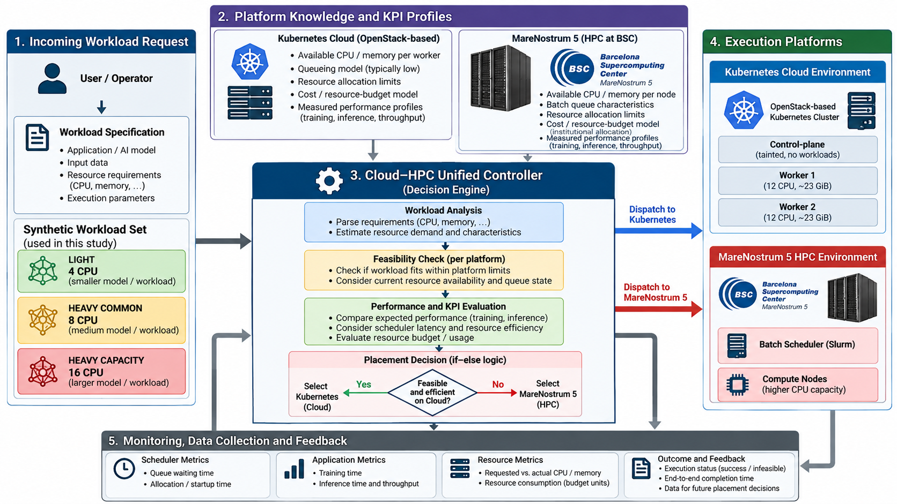

### Tier A — Manual Cloud-to-HPC Migration Baseline

Tier A represents the initial baseline used to validate the Cloud-to-HPC execution path before introducing automated placement and orchestration. In this stage, a workload is first prepared and executed in the Kubernetes cloud environment, after which the corresponding workload package, configuration, and required data are transferred manually to MareNostrum 5 (MN5). The workload is then adapted to the HPC execution model and launched through Slurm. This baseline demonstrates that an equivalent application can be moved from a cloud/Kubernetes execution context to the HPC platform while preserving its core workload semantics, and it provides the reference workflow against which the more automated Tier-B orchestration mechanisms are evaluated.


# MINERVA Cloud-HPC Orchestration Tier-B

MINERVA Tier-B is a research implementation of policy-aware workload placement
and execution across Kubernetes and an SSH-accessible Slurm HPC system. It
combines resource-feasibility assessment, operator approval and override,
Kubernetes execution, a lightweight Kube2HPC lifecycle controller, and paired
cross-platform benchmarking.

This publication workspace contains the historical Tier-B implementation plus
the audited B1.10 comparison extension. Infrastructure identifiers, credentials,
raw scheduler captures, generated benchmark results, and machine-specific paths
are intentionally absent.


## Architecture overview

```text
workload profile
      |
      v
placement / comparison controller
  |                       |
  v                       v
Kubernetes API        Kube2HPC-Lite
(Jobs and Pods)       (SSH + Slurm lifecycle)
  |                       |
  +----------+------------+
             v
 normalized B1.10 metrics and reports
```

The placement path recommends one target, asks for human review when required,
validates any override, and dispatches one execution. The comparison path is a
separate experimental intent that runs both feasible platforms sequentially and
records normalized evidence without changing placement policy.

## Architecture

The Tier-B Cloud-HPC orchestration architecture integrates workload specification, platform knowledge, feasibility analysis, placement decisions, execution on Kubernetes or MareNostrum 5, and monitoring/feedback.



## Tier-B capabilities

- Kubernetes resource discovery and per-node feasibility checks.
- Rule-based local/HPC placement recommendations.
- Explicit approve, reject, override, inspect, and compare actions.
- Kubernetes workload Job execution and result capture.
- SSH/Slurm preflight, submit, monitor, log, result, cancel, and timeout paths.
- Orphan-aware cancellation in the one-command HPC pipeline.
- B1.10 paired execution with stable workload profiles, ordered child runs,
  normalized timing/resource fields, semantic result comparison, CSV/JSON, and
  Markdown summaries.
- Explicit `RESOURCE_INFEASIBLE` handling that avoids submitting a Kubernetes
  Job which cannot fit any eligible node.

## Repository structure

| Path | Purpose |
|---|---|
| `src/` | Placement, orchestration, Slurm lifecycle, and benchmark normalization |
| `config/` | Workload catalog, cost-model template, and safe configuration examples |
| `job-specs/` | Slurm workload/lifecycle specifications |
| `k8s/` | Kubernetes RBAC, request, controller, workload, and preflight manifests |
| `workloads/` | Deterministic TensorFlow workloads and portable Slurm scripts |
| `scripts/` | Post-run resource analysis and plotting |
| `tests/` | Offline B1.10 unit and integration-style controller tests |
| `docs/` | Experimental timeline and B1.10 method/contract documentation |
| `artifacts/containers.md` | Validated container versions and digests; no image binary |

Runtime results belong under ignored `results/` and `artifacts/benchmarks/`
directories and must be reviewed before any separate publication.

## Prerequisites

- Python 3.10 or newer for the controller and offline tests.
- `kubectl` with an operator-supplied kubeconfig for Kubernetes execution.
- An SSH client, a configured SSH alias, and a pinned `known_hosts` entry for
  HPC execution.
- Slurm client commands on the remote system: `sbatch`, `squeue`, `sacct`, and
  `scancel`.
- SingularityCE/Apptainer and the validated TensorFlow image for the supplied
  Slurm workloads.
- Permission to create Jobs, ConfigMaps, and the documented RBAC resources in
  the selected Kubernetes namespace.

## Installation

Create an isolated Python environment and install the workload dependencies:

```bash
python3 -m venv .venv
. .venv/bin/activate
python -m pip install -r requirements.txt
```

The pinned TensorFlow/NumPy versions come from the validated container metadata.
The controller tests and post-run JSON/SVG analysis scripts require only the
standard library.

## Local reproducibility

The public offline verification path does not require Kubernetes, Slurm, SSH,
OpenStack, a kubeconfig, or any private credential:

```bash
PYTHONDONTWRITEBYTECODE=1 python3 -m unittest discover -s tests -v
PYTHONDONTWRITEBYTECODE=1 ./cloud-hpc --help
PYTHONDONTWRITEBYTECODE=1 python3 src/kube2hpc.py --help
PYTHONDONTWRITEBYTECODE=1 python3 src/run_pipeline.py --help
```

The 19 tests use synthetic scheduler records and mocked platform runners. They
exercise normalization, feasibility, comparison, partial failure, reporting,
CLI routing, and human-review control flow without contacting external systems.
The TensorFlow workloads themselves require the dependencies in
`requirements.txt` and are intended to run through the supplied Kubernetes or
Slurm definitions.

## Configuration

Start with [config/example.env](config/example.env) and
[config/targets.example.json](config/targets.example.json). Never commit the
populated files.

1. Create the ignored runtime target file:

```bash
cp config/targets.example.json config/targets.json
```

2. Replace `<HPC_SSH_ALIAS>` and `<PROJECT_PATH>` with local values.
3. Replace `<SLURM_ACCOUNT>` and `<SLURM_PARTITION>` in each selected job spec,
   or remove an option when the site does not require it.
4. Replace `<HPC_HOST>`, `<HPC_USER>`, and `<HPC_SSH_ALIAS>` in any Kubernetes
   offload/preflight manifest you intend to apply.
5. Set `PROJECT_PATH`, `CONTAINER_IMAGE_PATH`, `SINGULARITY_BIN`, or
   `SINGULARITY_MODULE` for the remote scripts when site defaults differ.
6. Set `CLOUD_HPC_NAMESPACE` and replace `<KUBERNETES_NAMESPACE>` when applying
   a manifest manually.
7. Set `KUBECONFIG` from the private `<KUBECONFIG_PATH>` only in the operator
   environment. Kubeconfigs, SSH keys, OpenStack RC files, and populated target
   files are ignored and must stay outside version control.

The supplied profile field `hpc_memory_per_requested_core_gb` controls the
normalizer's expected Slurm memory-policy calculation. Change it to the site's
documented value before interpreting `memory_policy_match`.

Tier-B consumes an existing Kubernetes API but does not call OpenStack APIs or
provision a cloud. `<OPENSTACK_PROJECT>` and `<OPENSTACK_AUTH_URL>` are included
only as operator-side deployment context; neither value is required by the
repository code.

## Infrastructure-dependent execution

The following workflows require user-provided Kubernetes and/or HPC services.
They reproduce the orchestration method, but they do not reproduce any private
institutional cluster. Resource availability, queue policy, accounting fields,
and timings will vary by deployment.

### Kubernetes/cloud execution

The controller defaults to namespace `cloud-hpc-workloads`; override it with
`CLOUD_HPC_NAMESPACE`. Manifests carry `<KUBERNETES_NAMESPACE>` so a site value
must be rendered before manual application. Create the namespace and bootstrap
the B1.7 request/RBAC resources as follows:

```bash
export CLOUD_HPC_NAMESPACE="<KUBERNETES_NAMESPACE>"
export KUBECONFIG="<KUBECONFIG_PATH>"

kubectl create namespace "${CLOUD_HPC_NAMESPACE}"
sed "s/<KUBERNETES_NAMESPACE>/${CLOUD_HPC_NAMESPACE}/g" \
  k8s/b1-7c-rbac.yaml | kubectl apply -f -
sed "s/<KUBERNETES_NAMESPACE>/${CLOUD_HPC_NAMESPACE}/g" \
  k8s/b1-7c-request.yaml | kubectl apply -f -

kubectl -n "${CLOUD_HPC_NAMESPACE}" create configmap \
  cloud-hpc-cpu-ai-v1-script \
  --from-file=train_cpu_ai_v1.py=workloads/tier-a/scripts/train_cpu_ai_v1.py \
  --dry-run=client -o yaml | kubectl apply -f -
```

`./cloud-hpc` creates or updates the controller-code and workload-catalog
ConfigMaps, renders the namespace placeholder, and applies the controller or
local workload Job. Do not apply `b1-7c-controller-job.yaml` before its input
ConfigMaps exist.

For HPC offload, create SSH material directly from private local files, never
from committed YAML:

```bash
export SSH_PRIVATE_KEY_PATH="<SSH_PRIVATE_KEY_PATH>"
export SSH_KNOWN_HOSTS_PATH="<SSH_KNOWN_HOSTS_PATH>"
kubectl -n "${CLOUD_HPC_NAMESPACE}" create secret generic kube2hpc-mn5-ssh \
  --from-file=id_ed25519="${SSH_PRIVATE_KEY_PATH}" \
  --from-file=known_hosts="${SSH_KNOWN_HOSTS_PATH}"
```

Secret creation is an operator action; no key, token, kubeconfig, password, or
OpenStack credential is included here. The local B1.6 and B1.10 workload
manifests can be used independently after reviewing their resource requests.

### HPC/Slurm execution

Stage the workload script, Slurm script, and container image below the configured
remote root. Then exercise the lifecycle directly:

```bash
python3 src/kube2hpc.py preflight job-specs/tier-a-replay.json
python3 src/kube2hpc.py submit job-specs/tier-a-replay.json
JOB_ID="<JOB_ID>"
python3 src/kube2hpc.py status "${JOB_ID}"
python3 src/kube2hpc.py logs "${JOB_ID}"
python3 src/kube2hpc.py result "${JOB_ID}"
python3 src/kube2hpc.py cancel "${JOB_ID}"
```

The guarded one-command version is:

```bash
python3 src/run_pipeline.py job-specs/tier-a-replay.json \
  --poll-seconds 5 --timeout-seconds 900
```

Site account and partition flags are passed through the job spec's
`sbatch_args`; the Slurm scripts deliberately contain no private account,
partition, QoS, installation path, or project filesystem path.

## Placement workflow

Run a catalogued workload in the default placement mode:

```bash
./cloud-hpc synthetic-light-v1
# equivalent explicit form
./cloud-hpc synthetic-light-v1 --mode PLACEMENT
```

The controller obtains Kubernetes capacity, evaluates the request, emits a
recommendation and reason, enters operator review where configured, then
dispatches only the accepted feasible target. This is an
infrastructure-dependent command; the local test suite validates its control
flow without contacting a cluster.

## Compare workflow

Run the same canonical profile on both platforms:

```bash
./cloud-hpc synthetic-light-v1 --mode COMPARE
./cloud-hpc synthetic-heavy-common-v1 --mode COMPARE
./cloud-hpc synthetic-heavy-v1 --mode COMPARE
```

`BOTH` is retained as a CLI alias for `COMPARE`. Kubernetes executes first and
Slurm second. Failure or infeasibility on one side is recorded without
suppressing the other, and artifacts are written beneath
`artifacts/benchmarks/<comparison-id>/`.

To create publication-safe local derivatives from reviewed comparison JSON:

```bash
python3 scripts/analyze_b110_cost_resources.py \
  --evidence artifacts/benchmarks
python3 scripts/plot_b110_results.py \
  --evidence artifacts/benchmarks
```

These output directories are ignored because generated evidence can contain
job IDs, timestamps, node names, and deployment details.

## Resource feasibility behavior

Kubernetes feasibility is evaluated per eligible node using requested CPU,
memory, GPU, and live allocations. A request that fits no node is recorded as
`RESOURCE_INFEASIBLE`; comparison mode does not create a predictably Pending
Job. Slurm feasibility remains the responsibility of the remote scheduler and
its site policy. Cross-platform CPU and memory units are reported in their
native scheduling domains and are not claimed to represent identical hardware.

## Human review and override

Placement mode supports approval, rejection, inspection, override, and explicit
comparison. An override is checked for feasibility before execution. Comparison
mode intentionally bypasses placement approval because both targets are the
declared experimental action; it does not mutate the recommendation policy.

## Reproducing generated analysis

After an infrastructure-dependent `COMPARE` run, the analysis commands above
consume the generated `comparison.json` records. They cannot produce meaningful
plots before such records exist. Generated JSON, logs, and SVGs are ignored and
must be reviewed and sanitized independently before sharing.

## Known limitations

- Cross-platform execution is sequential, not simultaneous.
- The implementation has no common energy telemetry source.
- Monetary results are unavailable until authoritative rates are supplied.
- Slurm accounting fields such as `MaxRSS` depend on site configuration.
- CPU utilization is unavailable without an external metrics source.
- The supplied Kubernetes YAML contains publication placeholders and must be
  reviewed for local namespace, security, storage, and scheduling policy.
- Raw validation evidence is not distributed in this repository.
- Exact reproduction of a private institutional cluster, scheduler policy, or
  benchmark timing is outside the scope of this public code artifact.

## Citation

Provisional software citation metadata is in [CITATION.cff](CITATION.cff).
Authors, release version, and any paper/DOI information must be confirmed before
publication; none has been fabricated here.

## License

This repository is licensed under the Creative Commons Attribution 4.0
International License (CC BY 4.0).

See [LICENSE.md](LICENSE.md) for details. The official license URL is
https://creativecommons.org/licenses/by/4.0/.

## Acknowledgements

This implementation was developed in the MINERVA Cloud-HPC research context.
Institutional, facility, project, and funding acknowledgement text remains to
be confirmed by the release owners before publication.

## Demonstration Video

A short demonstration of the Tier-B Cloud-HPC orchestration workflow is available here:

[Watch the Tier-B orchestration demo](demo/tier-b-orchestration-demo.mp4)


## Benchmark Result Plots

Publication-quality plots from the Tier-B B1.10 dual-platform benchmark are available in:

[`results/plots/`](results/plots/)
